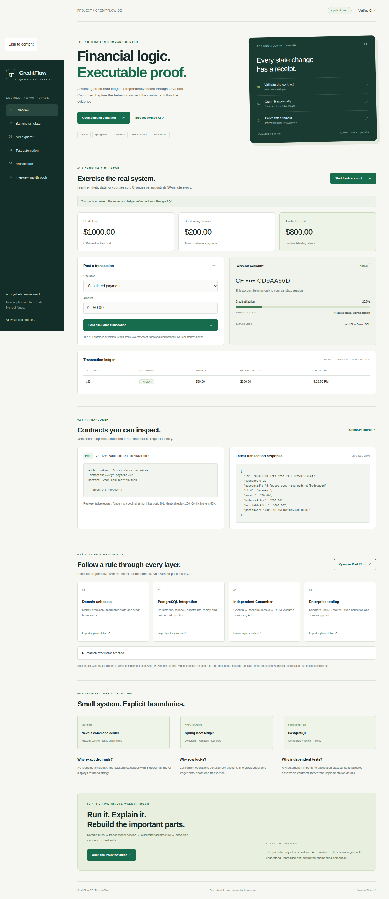

# CreditFlow QE custom-domain release

> **Historical deployment context** - This record retains its original milestone, source revisions, measured results and approval boundaries. Earlier hosting/source-visibility/pending-release statements are dated history. Use [the current production documentation](../railway-production.md) for the October 24-25 Railway topology, release state and remaining closeout.

**DEPLOYED / VERIFIED — 2026-10-15.** Canonical demo: https://creditflow.farhan-shafee.com

The owner explicitly approved connecting this hostname and updating CreditFlow's origin configuration. The existing portfolio and unused database role were outside this approval.

## Exact release and configuration

| Component | Verified source / configuration |
|---|---|
| Next.js frontend/BFF | `39e1728e6aca03f1e9c3d435a028e0316542edce`; Vercel `dpl_F6d4kYaLpdojbwBQ8aKUDKNmNkbe`, observed READY with the custom alias |
| Java API | Unchanged `20c91f5e10658ab4ce3ec7f2727c8a4934f5b314`; Railway `e0d833e4-2ed4-42a1-b32e-bfdd85bf22dd` |
| Authoritative DNS | One CNAME, `creditflow.farhan-shafee.com` → `7686ee5ba0d5ae26.vercel-dns-016.com`; TTL automatic, DNS-only |
| Cloudflare scope | Zone `40b0b65f2b8e58cdad31ddf5e7c95843`; new record `d96a0fd5d4df4d42d35d23d93d4fc3e9` |
| Vercel scope | Project `prj_oKV8BBgmOOjtRaHGDErtWNOEETJ3`, existing team, apps/web, Node 24.x |
| Production origin | `CREDITFLOW_WEB_ORIGIN=https://creditflow.farhan-shafee.com`; server-only Config value, read back after update |
| Old public URL | `https://creditflow-qe-pilot.vercel.app` returns 308 to the canonical hostname; following it returns 200 |

Vercel verified domain ownership without an additional TXT record. After attachment it returned the project-specific rank-1 CNAME above; that current recommendation was used instead of the earlier generic proposal. Only this Cloudflare record was added. The project domain redirect is a Vercel setting, not another Cloudflare DNS change.

The deployed frontend source passed both jobs in [Actions 38682147631](https://github.com/farhan-shafee/creditflow-qe/actions/runs/38682147631). The origin was redeployed from that exact source; no application-code change was required. The 30-second function limit, protected previews, other environment-variable metadata and existing resource settings were preserved. Railway, Neon, billing policies and existing projects were not modified in this domain release.

## Executed verification

| Gate | Actual result |
|---|---|
| Public DNS | Independent resolver returned the exact project-specific CNAME |
| HTTPS | 200, trusted TLS 1.3, certificate SAN matches creditflow.farhan-shafee.com |
| Deployment provenance | READY, production, exact source SHA and custom alias verified before banking tests |
| True cold start | Railway SLEEPING and Neon idle recorded before the first account request; POST 201 in **17,427 ms**; 5 checks passed |
| Custom-host banking | **10 checks passed**: initial ownership/state, exact purchase/payment, original receipt replay, conflict/overpayment/credit errors, old-origin rejection, tampered-cookie rejection and ledger reconciliation |
| Hosted Java UI module | **11 passed**, zero failures/errors/skips: Selenium 2, Playwright 4, BFF 4, trace-redaction unit test 1 |
| UI formatting/build | Maven verify and Spotless completed with exit 0 |
| Provider redirect | 308 to canonical hostname, then 200 on follow |

The UI run targeted the actual custom-host Vercel BFF → Railway API → Neon PostgreSQL path without server credentials. Its source was exported with explicit LF line endings. A temporary runner's first setup attempt referenced the wrong local deployment-receipt filename; zero tests ran in that attempt. The corrected runner then executed the complete module. The setup record is retained separately.

The cold-start sample began from provider metadata observed at 16:26:26 UTC. A 20-second BFF deadline handled that request beneath the 30-second function limit. This single measurement is not an availability or latency guarantee. The earlier provider-URL release and its original failures remain in [the historical pilot record](provider-pilot.md).

## Evidence and remaining scope

[Sanitized receipts and their SHA-256 index](custom-domain/) retain exact outcomes, provider IDs, source commits and timestamps. Test reports, logs, screenshots and redacted traces remain under ignored `.work/custom-domain`; cookies, credentials and environment payloads are excluded from committed evidence.

Synthetic sessions last 30 minutes. Existing conservative public quotas, exact-origin controls, server-key protection, account ownership, bounded bodies and exact decimal rules remain in place. No public CI/infrastructure control was introduced. The $15/month allowance remains a planning budget, not an enforced cap; no new plan, deploying seat or shared billing control was enabled.

Jenkins server execution and sustained-load/SLA claims remain unverified. The [fourth flagship card proposal](../portfolio-integration.md) is prepared for separate approval; the portfolio repository remains unchanged. The unused Neon bootstrap role still has its password disabled and was not deleted. This is an AI-assisted synthetic portfolio project, not a real bank or regulatory-compliance claim.
