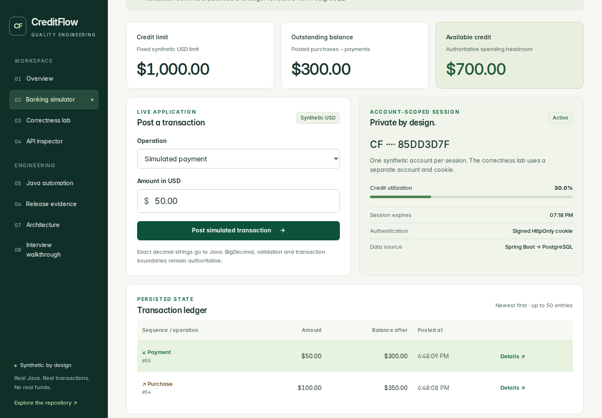

# Financial workspace production acceptance — November 4, 2026

**DEPLOYED / VERIFIED at the recorded times.** [CreditFlow QE](https://creditflow.farhan-shafee.com) runs frontend [b286242](https://github.com/farhan-shafee/creditflow-qe/commit/b286242e0b3e8f3aa1539a256662865ba4002ef1), Railway deployment `5af466c1-c2ba-4685-aad0-d431a08d7552`. [PR #7](https://github.com/farhan-shafee/creditflow-qe/pull/7) records the reviewed implementation and release history.

The dashboard applied only the approved branch/commit source fields once. Independent provider reads observed terminal SUCCESS, healthy services and no pending work. Non-source frontend configuration matched the pre-release baseline. Backend, PostgreSQL and monitor deployment identities did not change. Synthetic account/ledger data changed only through the approved bounded test journeys.

## Executed proof

[Full merged-main CI run 41886196621](https://github.com/farhan-shafee/creditflow-qe/actions/runs/41886196621) passed at this exact frontend revision. A fresh retained-artifact audit recomputed all five scopes: 31 unit / 18 PostgreSQL integration; each private/public mode 31 Cucumber scenarios, 154 steps and 6 TestNG cases; 37 Java UI/BFF cases; 57 frontend tests; 7 Bruno requests / 11 checks; 205 Maven components / 0 affected. All 192 report hashes and 22 command-log hashes matched. [Machine-readable CI validation](financial-workspace-20261104/ci-validation.json) retains source fingerprint, producer bounds and independently recomputed counts.

Public acceptance passed seven check groups using five synthetic accounts and 34 HTTP requests including assets. It verified purchases/payments, original receipts, ownership, complete ordered ledger reconciliation, insufficient credit, identical replay, conflicting reuse, inspector behavior, self-hosted fonts, reduced motion and responsive layout. A second read-only check verified settled mobile navigation using ten GET requests and no accounts. **Combined: five accounts / 44 requests, within five / 60 approved**, zero page errors and no origin/budget guard failures.

Actual capture at 1440 × 1000 after a 100 USD purchase and 50 USD payment: outstanding 300 USD, available 700 USD, two persisted receipts. The image is synthetic application data, with no session credentials. [Verification JSON](financial-workspace-20261104/verification.json) records its SHA-256 and exact deployment identity.

## Preserved failures and boundaries

Two connector deployment confirmations cancelled despite chat approval. The owner then separately approved Browser Use, signed in, and the exact reviewed dashboard patch was applied once.

Original navigation screenshot 06 caught smooth scrolling and was retained rather than accepted as architecture proof. The read-only check initially omitted computed 104px scroll padding. Later instrumentation showed the locator auto-scrolling before a sticky-header click, moving the document and changing the active section. Clicking the already-visible opener at its observed rendered position preserved the section and active indicator. The corrected checker passed locally and publicly without changing application code or financial assertions.

The original local proof bundle under `.work/financial-release-20261104` retains results, sources, nine inspected release captures, failed rehearsals and the verified 43-entry artifact index. Its digest is `47020939c96f55cfa3820c7102a72098b7e1a905a270b8233b94cf265155d576`. New metadata-audit attempts remain under `.work/evidence-polish-20261104`. Linux checkout fingerprint equality required the repository's LF/CRLF attribute rules; initial comparisons were rejected. The accepted isolated checkout matched all 282 source files and the exact CI fingerprint. Windows retained-artifact validation checked required command names/outcomes, report/log hashes, producer bounds, source identity and actual counts; exact Linux command-argument equality was not replayed.

This is point-in-time functional acceptance, not sustained-load, an SLA, banking settlement or regulatory compliance. No production transaction was added for this metadata refresh. Earlier [local Jenkins execution](jenkins-execution.md) remains separate; controller execution for this revision, cold starts/sleep behavior and spending caps were not revalidated. Expired CI downloads do not invalidate retained historical reports, and later commits require their own CI.
