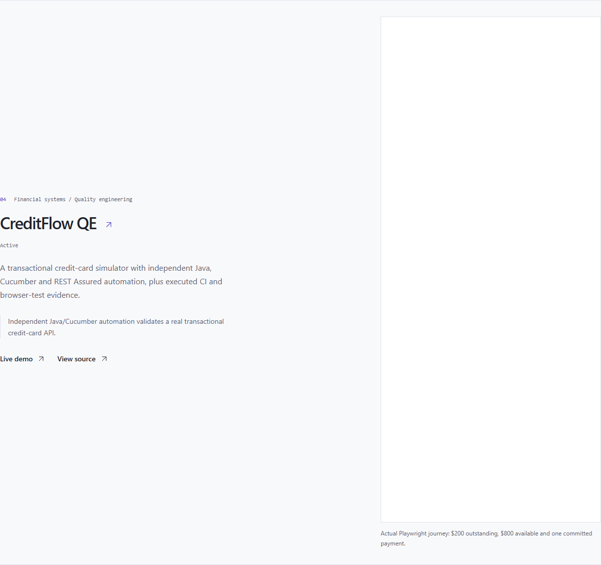

# Verified portfolio integration — 2026-10-15

**DEPLOYED / VERIFIED.** [Portfolio case study](https://farhan-shafee.com/work/creditflow-qe), [homepage](https://farhan-shafee.com) and [Work index](https://farhan-shafee.com/work) now expose CreditFlow QE as the fourth flagship. The owner separately approved applying and deploying the prepared card.

Portfolio repository: farhan-shafee/farhanshafee.com. Vercel project prj_cogbj7rjEkWVtCzulTSr9byTFn58 remains the existing project on its existing team. The actual domain uses the hyphen: farhan-shafee.com. No DNS record changed in this integration.

| Release item | Actual result |
|---|---|
| Implementation | 19c683f6cdbfa56f685a3d972c83d879da9b8660 |
| Released source | 9867fd2ccab55441165760ed67602e89bce76b3d on feat/creditflow-portfolio; pushed, clean, unmerged |
| Portfolio PR | https://github.com/farhan-shafee/farhanshafee.com/pull/1 |
| Vercel production | dpl_DQV4fVimiUPLNg11eFCVVZ6U6HUH; READY, staged and checked before promotion |
| Alias verification | Apex, www and existing provider alias all map to this deployment |
| Local unit/rendering/metadata | 37 passed, zero failures or skips |
| Local browser suite | 26 passed; 5 affected tests also passed after expanding screenshot and cold-load coverage to CreditFlow |
| Static/build checks | Build, TypeScript, ESLint and Prettier passed |
| Independent review | No Critical/Important findings; both minor documentation/coverage observations addressed |
| Source checks | All 14 changed-file hashes matched committed blobs; 97 source files scanned, Gitleaks 0 findings |
| Staged production | 7 checks passed with canonical alias still on prior deployment |
| Public postflight | 18 passed: trusted TLS1.3, routes, canonical metadata, unchanged order, image hash, indexes, retired-route 404, www redirect and demo reachability |
| Public UI | 2 actual homepage-to-case journeys at 375px/dark and 1440px/light passed; image loaded, links correct, no overflow or page runtime errors |
| Request sample | 43 bounded owner-CLI request records; 0 5xx at 2026-10-15T18:15:41.964Z; not availability or load evidence |

## Scope and retained failures

The approved record and actual synthetic payment image are reused through the existing card and case-study components. AegisGraph, CreditOps AI and TradeFlow remain in order, followed by CreditFlow and the same four supporting security projects. Original project and evidence records were compared byte for byte after removing only the new import/entry. Required evidence, llms.txt, README and independent hierarchy expectations were updated.

The deployment dry run initially included local test artifacts despite Git-ignore rules. Commit 9867fd2ccab55441165760ed67602e89bce76b3d adds explicit Vercel exclusions; the verified manifest contains 96 reviewed regular source files, no unsafe/untracked regular files and only two empty artifact directory entries. No excluded screenshot/result content was uploaded.

The initial browser setup used an occupied port and executed zero tests; that process was left untouched. One temporary public UI selector omitted the existing screen-reader text “opens in a new tab” and timed out. Its original runner and failure screenshot are retained; exact accessible-name and href checks then passed without changing application code. Original missing registry/index test failures were fixed at their source.

The Vercel connector returned 404 for promotion. The advertised same-endpoint owner-CLI fallback was used with explicit project/team scope. Its promotion helper expected JSON from a response without parsable JSON; all aliases were then inspected read-only and verified on the new deployment before any retry. No repeated promotion, protection change or Browser Use/cloud-browser session occurred.

## Dependency review remains REVIEW

Validation found inherited portfolio dependency findings. Compatible project-local patches update Next.js/eslint-config-next to 16.3.8, Sharp to 0.35.5 and source-map-js to 1.2.2. Full npm audit still exits 1: 5 high development-tooling and 4 moderate affected-package entries; production-only audit exits 1: 4 moderate, 0 high/critical. These are not passing audits. No suppression, major downgrade or replacement parser was introduced. The source-only portfolio release note documents reviewed input paths and remaining maintenance. This does not establish absence of exploitable defects.

The CreditFlow frontend/API/database, existing DNS, billing, credentials, system software and other deployed projects were not modified. Both project PRs remain unmerged. Jenkins server execution, sustained-load/SLA claims and deletion of the unused Neon role remain outside this release.

[Sanitized receipts and hashes](portfolio-integration/) retain exact sources, deployment IDs and outcomes. Private raw logs and temporary runner state stay outside Git.

