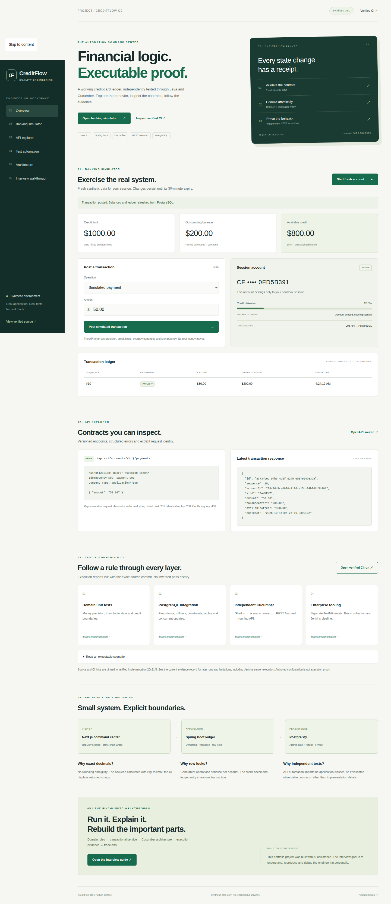

# Provider-URL pilot — verified release record

> **Historical deployment context** - This record retains its original milestone, source revisions, measured results and approval boundaries. Earlier hosting/source-visibility/pending-release statements are dated history. Use [the current production documentation](../railway-production.md) for the October 24-25 Railway topology, release state and remaining closeout.

Historical provider-URL receipt. The separately approved [custom-domain release](custom-domain.md) is now canonical at https://creditflow.farhan-shafee.com; the original receipts and hashes below are preserved.

The owner approved an isolated public provider-URL pilot. This is a synthetic portfolio system, not a production bank. DNS, existing portfolio edits, plan upgrades and new paid seats were outside this approval.

- Command center: https://creditflow-qe-pilot.vercel.app
- API liveness: https://banking-api-pilot.up.railway.app/actuator/health/liveness
- Public API contract: https://banking-api-pilot.up.railway.app/openapi.yaml

## Component provenance

| Component | Deployed source | Provider identifier |
|---|---|---|
| Java API | `20c91f5e10658ab4ce3ec7f2727c8a4934f5b314` | Railway deployment `e0d833e4-2ed4-42a1-b32e-bfdd85bf22dd` |
| Next.js BFF / dashboard | `b3209d36d979b9b2c3bfe1850882db3481839e65` | Vercel deployment `dpl_BY8Zuk3AiYDb5GGixUVjmwqZeL82` |
| PostgreSQL | Flyway V1, isolated PostgreSQL 17 | Neon project `shiny-scene-38527470` |

The Java source did not change in the frontend timeout fix. It remains pinned to its independently verified deployment rather than being rebuilt for a cosmetic SHA match. Vercel was observed READY, with the canonical production alias and exact Git SHA, before public requests were tested.

API source CI: [38677641852](https://github.com/farhan-shafee/creditflow-qe/actions/runs/38677641852). Frontend release CI: [38680627735](https://github.com/farhan-shafee/creditflow-qe/actions/runs/38680627735). Both jobs passed for each revision. The latter executed PR merge HEAD `bb169a6f591e60ebd94358c82da5b9ae12e4093f`, with PR head b3209d3. All five artifact manifests have source fingerprint `455cd521c3fce8a79353382fb313434aba007b14156b61cfc5ec2a1469ecf778`; all **174** report/log hashes matched independently after download.

## Actual verification

| Environment / gate | Result |
|---|---|
| Release CI unit / real PostgreSQL integration | 31 / 18 passed |
| Release CI Cucumber, each private/public mode | 31 scenarios / 154 steps passed |
| Release CI TestNG, each mode | 6 passed |
| Release CI UI/BFF/redaction | Selenium 2, Playwright 4, BFF 4, redaction 1 passed |
| Release CI frontend / evidence-framework tests | 5 / 32 passed |
| Release CI Bruno | 7 requests / 11 checks passed |
| Release CI quality | Spotless, SpotBugs, build and types passed; OSV 0 affected / 209 Maven components; npm audit and Gitleaks 0 findings |
| Release CI JaCoCo | 222/239 lines, 101/119 branches |
| Hosted API smoke, API commit 20c91f5 | 24 checks passed, including exact decimal postings, replay/conflict, ownership, validation, concurrency and reconciliation |
| Hosted database privilege/TLS probe | 3 allowed operations, 4 forbidden operations denied; fixtures rolled back; client-to-Neon-proxy TLS 1.3 with truststore and hostname validation |
| Genuine sleeping-backend first request | Railway SLEEPING + Neon idle observed first; account POST 201 in **14,767 ms**; 5 checks passed |
| Hosted API restart persistence | Purchase and payment committed before restart; complete account/ledger snapshot and original replay receipt unchanged after confirmed startup |
| Hosted Java UI suite | 11 passed: Selenium 2, Playwright 4, BFF 4, redaction 1; zero failures/errors/skips; Spotless passed (exit 0) |

The hosted tests target the actual Vercel → Railway → Neon system. They are distinct from CI's isolated local PostgreSQL/browser stack. Public UI tests use sessions and the public HTTPS origin without API provisioning keys. One redaction unit test is included in the 11-test module count; the six browser journeys and four BFF contracts exercise hosted behavior.

The cold-start prestate was recorded at 2026-10-15T04:22:12.947Z, before any wake-up HTTP probe. The account request then succeeded on its first attempt. The backend has a 20-second BFF deadline beneath a 30-second Vercel function limit. This is one measured cold start, not a latency guarantee.

## Retained failures and corrections

1. Railway's first build, deployment `16220617-cb9e-4ab7-8dc1-3b1838407000`, rejected the optional Maven cache mount because its provider-required ID was absent. The portable image removes that optional mount; the succeeding image and CI evidence are preserved.
2. The first real cold test on the 8-second BFF returned 503 BACKEND_UNAVAILABLE at 8,185 ms. Java needed 12.29 seconds to start. The new 20-second deadline succeeded without disabling sleep or increasing CPU/RAM.
3. The initial ad-hoc ownership probe expected 401 for another valid account credential. The implemented, already-tested privacy contract is 404 ACCOUNT_NOT_FOUND. The probe was corrected to require that exact status/code; the application was not changed to fit the probe.
4. The first hosted UI command passed all 11 functional tests but failed its final Spotless goal because Windows Git export produced CRLF Java files. Per-command `core.autocrlf=false` **and** `core.eol=lf` produce exports matching the committed blobs. Git settings and test assertions were not changed. Original reports/logs remain separate from the canonical rerun.
5. A preliminary TLS probe incorrectly treated `pg_stat_ssl` as the external client socket. Neon proxies the connection, so that view reports the internal proxy-to-PostgreSQL hop. The corrected JDBC probe observed the actual TLS 1.3 socket while retaining the standard truststore and verify-full hostname checks. It does not claim encryption characteristics for the provider's internal hop.

## Isolation, limits and account preflight

- Railway: new private control-plane project `d76d1a2a-17bb-42e2-b192-481a83f1cfab`; one public API replica, 0.5 vCPU, **500,000,000 bytes RAM**, sleep enabled, no volume, liveness health check. A one-hour, 30-second sampling window measured maximum RAM 0.182665216 GB and CPU 0.2494289 vCPU; these sampled values are not sustained-load capacity evidence.
- Neon: fresh Free project/database, fixed 0.25 CU, five-minute idle suspension. API field zero uses the provider default; it does not disable suspension. Migration identity is separate from `creditflow_runtime`; runtime cannot run migrations, create schema objects or rewrite/delete ledger entries. TLS was verified through an actual JDBC connection.
- An unused API-created bootstrap role, `creditflow_service`, received excessive provider privileges. It was never used by the application. Its password was disabled, and the former generated credential was verified to fail authentication. The role object remains; deleting it needs the owner's separate deletion approval.
- Vercel: separate project `prj_oKV8BBgmOOjtRaHGDErtWNOEETJ3`, apps/web, Node 24.x, standard function memory, basic fixed build, iad1, no elastic build concurrency, 30-second functions. Production-only server variables; fresh independent signing key; preview authentication remains enabled.
- Public safety: server-key-protected direct API operations, owned expiring accounts, Secure/HttpOnly/SameSite=Strict cookies, exact-origin BFF writes, bounded bodies and deadlines, exact amount validation, 20 sandbox creations per observed peer/hour and 300 requests per peer/minute. Rate counters are single-replica process-local and reset on restart; there is no unrestricted public administration or CI trigger.
- Read-only preflight verified existing Railway Hobby active ($0.46 usage, $5 included usage), existing Vercel Pro/Owner ($0.78 of $20 usage credit consumed), and Neon Free eligibility. No subscription, seat or shared spending policy changed. These are preflight observations, not a final invoice.

The **$15/month allowance is a planning budget, not an enforced spending cap**; review around $10. Resource limits reduce exposure but do not enforce that dollar amount. Included credits, network traffic and later usage affect actual cost. Free-plan exhaustion can suspend the demo; do not automatically upgrade.

## Evidence files and remaining boundaries

The [sanitized receipts](provider-pilot/) preserve actual outcomes, provider IDs, source SHAs, timestamps and report hashes. Raw local execution material remains ignored under `.work/cloud-pilot`; secrets, cookies, connection strings and environment payloads are excluded. Hosted CI artifact retention ends 2026-10-29. The checked-in receipt survives that expiry.

Jenkins server execution, long-running soak/load behavior, availability/SLA and final invoice cost remain unverified. DNS/custom HTTPS and existing portfolio integration have not been applied. See [the concrete portfolio proposal](../portfolio-integration.md) and [readiness/cost review](../deployment-readiness.md). The project is AI-assisted and uses only synthetic data.
