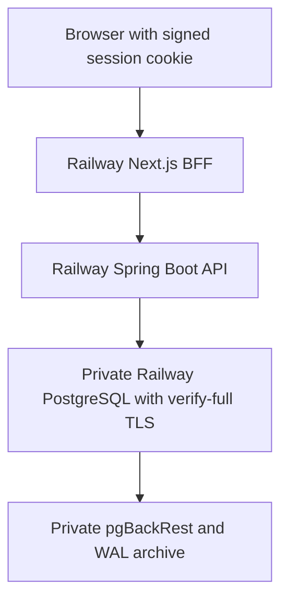

# CreditFlow QE on Railway

Current production topology reviewed October 25, 2026. [Live synthetic demo](https://creditflow.farhan-shafee.com) · [Public source](https://github.com/farhan-shafee/creditflow-qe).

The canonical Next.js command center, original Spring Boot API and live PostgreSQL database now run on Railway. The project/environment still have legacy pilot labels; those labels do not make Neon or Vercel the active providers. Cloudflare supplies DNS. The retained Neon application role is write-frozen and Vercel/rehearsal resources remain retained.

Synthetic data only: no real cards, customers, funds, settlement or regulated banking claim. The existing account-ownership, exact-money, atomic ledger and idempotency contracts are unchanged.

## Released source and runtime

These releases are deliberately pinned; a new `main` documentation commit does not automatically replace either production application.

| Component   | Observed release/configuration                                                    |
| ----------- | --------------------------------------------------------------------------------- |
| API         | `20c91f5e10658ab4ce3ec7f2727c8a4934f5b314`, `feat/provider-pilot`                 |
| Web         | `7a16b50b595d01c735ae566e9737b24b6121eaf6`, `ops/railway-frontend-pilot-20261024` |
| API build   | Repository-root `infrastructure/Dockerfile.api`; Java 21                          |
| Web build   | `infrastructure/Dockerfile.web` from the pinned frontend release; Node 24         |
| API health  | `/actuator/health/liveness`; separate protected database readiness                |
| Web health  | `/`, port 3100                                                                    |
| API runtime | One replica, 0.5 vCPU / 500 MB; API sleep disabled October 25                     |
| Web runtime | One replica, 0.5 vCPU / 500 MB; web sleep remains enabled                         |
| Database    | Private PostgreSQL, 1,024 MB volume; no public SQL proxy                          |
| Monitor     | Five-minute read-only health, identity, TLS, backup and archiver checks           |

The frontend may wake from idle. The former Neon five-minute sleep behavior is historical and no longer describes the live database. API sleep was disabled after a recorded liveness 503 during a stop/start; post-change checks passed. This is not an uptime or restart guarantee.

## Configuration and authority

Keep the BFF's API origin, exact public web origin, signing secret and provision key server-only. Do not expose them through `NEXT_PUBLIC_*` or enable local-demo mode publicly. Browser requests use signed HttpOnly SameSite cookies and exact-origin write checks; the API separately requires its provision key and account ownership.

The API connects to the production Railway database with a restricted runtime role, `sslmode=verify-full`, a project-specific CA trust file and hostname validation. `CREDITFLOW_DB_CA_B64` is resolved privately at startup to the protected CA file; no credential or connection URL belongs in a README, artifact or log. Runtime Flyway remains disabled. Apply schema changes separately with the migration identity.

The production runtime permits intended ledger insertion/account-balance updates and expiry cleanup, while denying direct ledger UPDATE/DELETE, expiry UPDATE and schema creation. RLS protects active accounts from cleanup deletion. Tests with privileged fault-injection fixtures run only against owned disposable databases, never production.

## Migration and acceptance

Writes reopened October 25 at approximately 05:36 UTC after a consistent frozen-source export, target restore, data/schema/sequence comparison, actual deployment-identity verification and synthetic banking acceptance. The release guard caught and corrected an earlier platform build mismatch before writes reopened.

The cutover recorded nineteen production acceptance checks, including synthetic account purchase/payment/replay and ownership behavior; all five accounting invariant counts were zero. Those are dated cutover checks, not a claim of a fresh production transaction during documentation maintenance.

After disabling API sleep, the reviewed API deployment reached SUCCESS at 12:38:24 UTC. Canonical web, unauthorized API rejection, liveness and protected database readiness passed; subsequent monitor outcomes and bounded error/HTTP checks passed through the recorded closeout window.

## Backups, recovery and open closeout

Private off-volume pgBackRest storage provides weekly full/daily differential backups and continuous WAL archiving, with four retained full backups. A new production full containing the fresh restore completed October 25 at 05:32:11 UTC, and accepted canary WAL reached the archive. Isolated preparation demonstrated archived chosen-time recovery with timestamp canaries and sequence reservations; the production cutover did not destructively restore the live database.

**Still pending as of October 25:** observe the first scheduled daily backup cycle and continue stabilization before approving retirement. An initial or manual full backup does not prove that scheduled cycle. Full weekly/retention expiry, every archive-object/dependency chain, sustained capacity, cross-provider disaster independence and RPO/RTO are not guaranteed.

The five-minute monitor validates health, live cluster identity, TLS, backup metadata/freshness and archiver progress. It emits structured results and failed cron executions; end-to-end chat notification delivery has not been established. Review every failed outcome, missing result, archive error and actual disk capacity rather than relying only on the newest passing line.

A recovery drill must use a fresh isolated volume, compatible image and selected successful backup. Disable recovered-instance archiving and public SQL exposure, wait for recovery completion, then validate data/schema/authorization/invariants. A production replacement requires a separate reviewed service/volume and archive destination.

## Release and rollback discipline

1. Review source, CI, migrations and pinned deployment settings before a separately authorized application release. Documentation publication does not unpin services.
2. Preserve private verified TLS, restricted runtime grants, runtime Flyway disabled, server-only keys and exact origins.
3. Require terminal SUCCESS at the actual approved source SHA; liveness alone does not prove database readiness.
4. Check canonical HTTPS, unauthorized rejection, protected readiness, scoped monitor outcomes, bounded runtime/archive errors, HTTP 5xx and capacity. Public transaction canaries require their own authorized synthetic scope.
5. Keep retained rollback and rehearsal resources until scheduled backup/stability gates pass and deletion is separately approved.

**Do not point the API back at stale Neon after Railway accepts writes.** Freeze writers and preserve/reconcile or reverse-migrate new state under a controlled recovery plan, or roll forward. The original source export is a frozen pre-cutover artifact, not a backup of later Railway writes.

## Historical records

The [provider pilot](evidence/provider-pilot.md), [custom-domain release](evidence/custom-domain.md), [completion evidence](evidence/completion.md), [October 15 maintenance](evidence/maintenance-handoff.md) and [frontend pilot](railway-frontend-pilot.md) retain their original revisions, measured outcomes and failed attempts. Vercel/Neon topology and cold-start samples in those records are historical. Use this document and the [release configuration contract](../infrastructure/release-environment.md) for current hosting.
